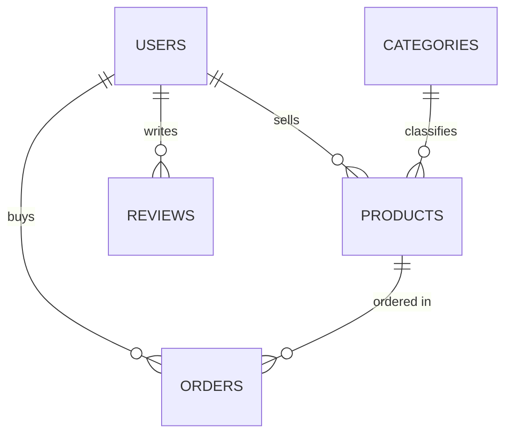

# 🛒 UBUY Marketplace

A Customer-to-Customer (C2C) e-commerce platform built for South Africa's informal economy: a place where township traders, side-hustlers and everyday sellers can list goods, reach buyers and track orders, instead of relying on cash, WhatsApp groups and manual EFT confirmations.


**🔗 Live demo:** http://ubuymarketplace.infinityfree.io/

## Overview

Roughly one in five employed South Africans works in the informal sector, and the township economy is estimated at around R900 billion a year. Yet most of that trade is undigitised: informal traders sell through social media posts and chat messages, with no verified identities, no structured listings and no order history. That leaves both buyers and sellers exposed to scams, disputes and lost trust.

UBUY Marketplace is a working prototype of a locally focused alternative. Anyone can register as a buyer or a seller, sellers post listings with photos and prices, buyers search, filter and check out, and a role-based admin panel keeps the platform moderated.

It was built as a semester software engineering project using only the required stack (PHP, MySQL, HTML, CSS and JavaScript) with no CMS and no e-commerce framework.

## Features

**For buyers**
- Register and log in with hashed passwords and live form validation
- Browse the marketplace, search by keyword and filter across six categories
- Product detail pages with seller name and province
- Session-based cart with a live item count in the navbar
- Checkout flow with delivery details and an order confirmation page
- "My Orders" history with order status tracking

**For sellers**
- Post listings with title, category, price, description and a product image
- Manage, edit and delete your own listings from a personal dashboard

**For administrators (Role-Based Access Control)**

| Role | View users, listings and orders | Delete users and listings | Change user roles |
|---|:---:|:---:|:---:|
| Moderator | ✅ | ❌ | ❌ |
| Admin | ✅ | ✅ | ❌ |
| Super Admin | ✅ | ✅ | ✅ |

## Tech Stack

| Layer | Technology |
|---|---|
| Frontend | HTML5, CSS3, JavaScript, jQuery, Bootstrap 5, Bootstrap Icons |
| Backend | PHP 8 (PDO, native sessions), no framework |
| Database | MySQL (5 relational tables with foreign keys) |
| Hosting | InfinityFree (Apache + MySQL) |
| Tooling | VS Code, XAMPP, phpMyAdmin, Git |

## Architecture Notes

The app is a classic multi-page PHP application organised around reusable includes. The navbar and footer are shared partials, a single `db.php` provides the PDO connection, and each page handles its own request logic before rendering. Form submissions post to dedicated action scripts in `includes/` (register, login, post listing, checkout), which validate input, talk to the database and redirect.

Authentication is session-based: a successful login stores the user's id, account type and role in `$_SESSION`, and every protected page checks that session before doing anything. The admin panel layers RBAC on top, so the role is checked on the server for every admin page and every destructive action, not just hidden in the interface.

Deleting records safely was a real design problem: because orders reference products and users through foreign keys, removing a listing or a user means removing their dependent rows first. Those cascades are handled explicitly in the delete handlers.



### Project structure

```
ubuy-marketplace/
├── admin/            Admin panel (users, listings, orders)
├── assets/           CSS, JavaScript and static images
├── database/         ubuy_db.sql (schema + categories)
├── includes/         db.php, navbar, footer, action scripts
├── uploads/products/ Uploaded product images
├── index.php         Home page
├── listings.php      Browse, search and filter
├── product.php       Product details
├── cart.php, checkout.php, order_confirmation.php
├── login.php, register.php, dashboard.php
└── my_listings.php, my_orders.php, post_listing.php, edit_listing.php
```

## Getting Started

You'll need [XAMPP](https://www.apachefriends.org) (Apache, PHP 8 and MySQL).

```bash
git clone https://github.com/Addie3000/ubuy-marketplace.git
```

1. Copy the cloned folder into `C:\xampp\htdocs\`
2. Start **Apache** and **MySQL** in the XAMPP Control Panel
3. Open `http://localhost/phpmyadmin`, create a database named `ubuy_db`, then import `database/ubuy_db.sql`
4. Visit `http://localhost/ubuy-marketplace/`

The default database settings (`localhost`, user `root`, no password) work with a fresh XAMPP install. For a live host, create `includes/config.live.php` with your own `$host`, `$dbname`, `$username` and `$password`. That file is git-ignored, so credentials never reach the repository.

### Creating an admin

Register a normal account in the app, then promote it in phpMyAdmin:

```sql
UPDATE users SET role = 'superadmin' WHERE email = 'you@example.com';
```

Valid roles are `user`, `moderator`, `admin` and `superadmin`.

## Security

- Passwords hashed with `password_hash()` and checked with `password_verify()`
- PDO prepared statements on every query to prevent SQL injection
- Output escaped with `htmlspecialchars()` to prevent XSS
- Client-side and server-side validation (phone number, password strength, matching passwords)
- Server-side role checks on every admin page and action
- Image uploads restricted to JPG, PNG and WEBP with generated filenames

## Known Limitations

This is a prototype, and a few things are intentionally simplified:

- **Payments are a mock form.** No real payment is processed and no card data is stored.
- **Delivery is a flat R50 fee**, with no courier integration.
- **The "verified seller" idea is not backed by real identity verification.**

## Roadmap

- [ ] Real payment gateway (PayFast / Peach Payments)
- [ ] Courier and township delivery integration
- [ ] Seller reviews and ratings in the interface
- [ ] Email notifications for new orders
- [ ] Multi-language support and a low-data mode

## License

Distributed under the MIT License. See `LICENSE` for details.

## Author

**Addie**, Software Engineering student, South Africa
GitHub: [@Addie3000](https://github.com/Addie3000)
